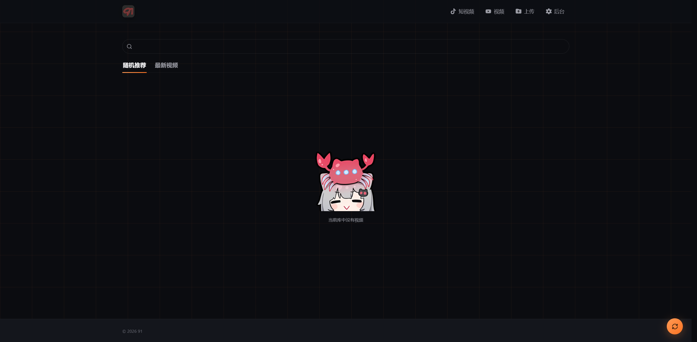
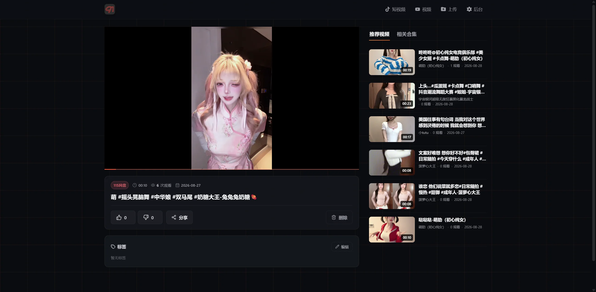
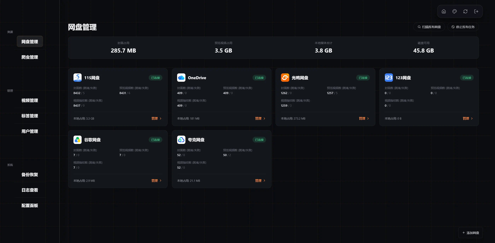

# Omni-Media-Vault（全能媒体库）

<p align="center">
  😄 个人私有全能媒体站 · 视频 / 图片 / TG转存 / X推文采集 😄
</p>

本项目基于开源私有视频站项目架构进行深度定制与增强，融合了 Telegram 媒体转存、相册图集归档、X（原 Twitter）推文视频提取及全屏画廊浏览等能力。

---

## 🌟 核心功能特性

### 1. 全能媒体转存与采集
- **Telegram 全媒体转存**：通过 Telegram 机器人，不仅支持转存视频文件，还全面支持**照片、多图相册（Media Group）**自动批量下载归档。
- **X / Twitter 视频一键提取**：向 Telegram 机器人直接发送 Twitter / X 推文链接，后台自动调用 `yt-dlp` 解析并下载最高画质视频。
- **智能标签与分类**：
  - 自动打标 `TG`（Telegram 来源）、`X`（Twitter 来源）、`图片` 等系统标签。
  - 自动从 Telegram 消息配文或推文正文中提取 `#话题` 转化为分类标签，支持秒级筛选与检索。

### 2. 沉浸式多媒体浏览体验
- **专业播放器**：基于 ArtPlayer 深度定制，支持 MP4、WebM、HLS 切片流，支持双击快进、滑动调节音量/亮度与手势操控。
- **三屏画面模式**：竖屏视频支持三屏并行对比播放。
- **短视频/沉浸流模式**：一键切换抖音式全屏沉浸流，上下无缝滑动刷片。
- **高清图片画廊**：针对图片类型媒体内置高颜值查看器，支持高分辨率原图自适应、缩放查看、全屏灯箱轮播与快捷原图下载。

### 3. 多网盘与本地存储无缝接入
- **多网盘挂载**：支持 115、PikPak、123网盘、联通沃盘、光鸭网盘、OneDrive、Google Drive、WebDAV 等。
- **低带宽 302 模式**：115、PikPak、123网盘、联通沃盘、光鸭网盘、OneDrive 原生支持 302 重定向直链模式，播放不消耗服务器宝贵带宽。
- **本地存储与目录同步**：支持挂载本地磁盘与现有媒体目录。

### 4. 安全、分享与扩展
- **一次性分享（阅后即焚）**：生成的分享链接仅能打开播放一次，无需登录即可观看，保护私密性。
- **企业级鉴权与防爆破**：密码采用加盐 `bcrypt` 存储，无预置后门；内置 30 分钟内连续失败 3 次自动封禁 IP 机制；网络请求防 SSRF 与重定向 Token 隔离。
- **自定义爬虫扩展**：支持接入标准化 Python 爬虫脚本，定时增量抓取流媒体资源。

---

## 🖼️ 页面预览





---

## 🚀 快速开始

### 方式一：一键安装脚本（推荐生产环境）

```bash
sudo apt update && sudo apt install -y curl ca-certificates
curl -fsSL https://raw.githubusercontent.com/z08w12/omni-media-vault/main/install.sh -o install.sh
sudo bash install.sh
```

部署完成后，在浏览器访问：`http://服务器IP:9191/`

安装后系统自动注册 `91` 管理命令（保持原有极简运维习惯）：
```bash
91                  # 打开可视化交互管理菜单
91 status           # 查看服务运行状态
91 logs             # 实时追踪服务日志
91 restart          # 重启服务
91 stop             # 停止服务
91 reset-password   # 重置管理员密码（随机生成安全密钥）
91 update           # 更新到最新版本
```

---

### 方式二：Docker Compose 部署

**1. 准备目录**
```bash
mkdir omni-media-vault && cd omni-media-vault
```

**2. 拉取仓库内置 `docker-compose.yml`**
```bash
curl -fsSL https://raw.githubusercontent.com/z08w12/omni-media-vault/main/docker-compose.yml -o docker-compose.yml
```

**3. 启动容器**
```bash
docker compose up -d
```

**常用 Docker 管理命令：**
```bash
docker compose pull && docker compose up -d             # 更新并重启
docker exec -it video-site-91 ./server reset-password   # 重置密码
docker compose logs -f                                  # 查看容器日志
```

---

### 方式三：源码本地一键部署与更新（推荐二次开发）

如果在服务器上需要保留 Git 源码并支持即时定制：

```bash
git clone https://github.com/z08w12/omni-media-vault.git
cd omni-media-vault
sudo bash deploy.sh install
```

后续如有代码更新，只需在仓库目录下执行：
```bash
git pull
sudo bash deploy.sh update
```
脚本会自动重新编译前端与后端二进制，并安全平滑重启系统服务。

---

## 📁 数据存放位置

**一键脚本部署**
- 运行配置文件：`/opt/video-site-91/config.yaml`
- SQLite 数据库：`/opt/video-site-91/data/video-site.db`
- Telegram 转存媒体库：`/opt/video-site-91/data/telegram/library/`
- 缩略图、预览片段与缓存：`/opt/video-site-91/data/`

**Docker Compose 部署**
- 运行配置文件：`./data/config.yaml`
- 数据库文件：`./data/video-site.db`
- Telegram 转存媒体库：`./data/telegram/library/`

---

## 🛠️ Telegram 与 X 转存配置

详细的 Telegram 机器人配置、本地 Telegram Bot API 高速模式（支持 2GB 大文件下载）部署说明，请参阅：
👉 [Telegram 接入指南](backend/docs/Enable_Telegram.md)

对于旧版 `telegram-media-vault` 的数据无缝迁移，请参阅：
👉 [数据迁移与融合指南](docs/TELEGRAM_MEDIA_VAULT_MERGE.md)
👉 迁移执行脚本：`python3 scripts/migrate_telegram_media_vault.py --db /path/to/old.db --media-dir /path/to/old/media`

---

## 📜 使用须知

- 本项目仅供个人学习、技术研究及私有化部署使用。
- 用户使用转存与爬虫功能时请遵守当地法律法规，尊重版权方的合法权益。

---

## 👏 致谢

- [91](https://github.com/nianzhibai/91) — 优秀的开源私有流媒体站基座
- [telegram-media-vault](https://github.com/z08w12/telegram-media-vault) — Telegram 媒体转存与推特抓取参考实现
- [ArtPlayer](https://github.com/zhw2590582/ArtPlayer) — 现代化功能完善的 HTML5 播放器
- [yt-dlp](https://github.com/yt-dlp/yt-dlp) — 强大的命令行音视频提取利器
- [OpenList](https://github.com/OpenListTeam/OpenList) — 优秀的网盘接口设计参考
