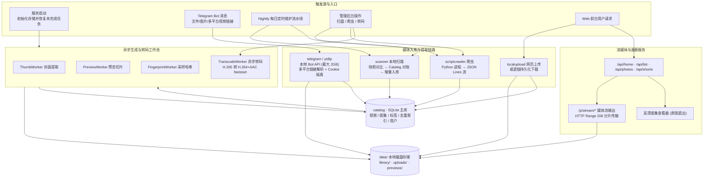
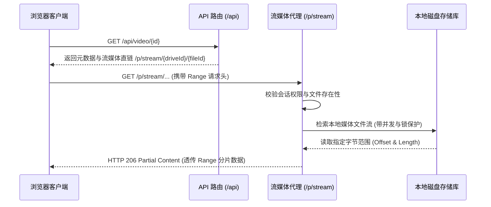

# Omni-Media-Vault 后端服务（Go）

本文档详细说明 `omni-media-vault` 后端服务的架构设计、运行流程、数据流向及模块划分。

---

## 快速开始

### 环境依赖
- **Go 1.23+**
- **ffmpeg / ffprobe**：用于视频封面抽帧、多段预览切片、浏览器兼容性探测、异步转码及内容级去重（必装；命令路径可在配置中自定义）。
- **yt-dlp**：用于多平台视频解析与提取（X/Twitter、YouTube、TikTok、抖音、B站等，必装；支持配置独立 Cookie 与专用插件）。
- **python3**：用于自定义爬虫扩展及存量数据迁移脚本。
- **SQLite**：采用纯 Go 驱动（modernc），无需依赖 CGO 或系统动态链接库；依赖已 vendored，支持完全离线构建。

### 编译与启动

```bash
cd backend
go run ./cmd/server        # 首次启动自动从 config.example.yaml 生成 config.yaml，默认监听 0.0.0.0:9191
go test ./...              # 运行单元测试；缺少外部环境依赖（ffmpeg/python3）时相关测试自动跳过
go build -o server ./cmd/server
```

前端开发在仓库根目录执行 `npm run dev`，Vite 开发服务器会自动将 `/api`、`/p`、`/admin/api`、`/peer` 反向代理至后端的 `9191` 端口。全部配置项及注释详见 [config.example.yaml](config.example.yaml)。

> [!NOTE]
> 每次启动时，服务会先迁移旧版配置，再按随程序打包的 `config.example.yaml` 重建实际配置文件：保留模板中同名字段的已有值，缺失字段自动使用模板默认值，更新完成后原子替换原文件。升级无需手动复制模板。

---

## 项目目录架构

仓库根目录是前端（Vite + React），`backend/` 是 Go 后端服务：

```
omni-media-vault/
  src/                      前端源码：admin/ 管理后台、pages/、components/、lib/、styles/
  tests/                    前端自动化测试
  index.html public/        前端入口与静态资源
  scripts/                  数据迁移与辅助脚本
  install.sh start.sh       一键安装脚本、本地启动开发环境脚本
  deploy.sh Dockerfile      源码自动编译与容器编排配置
  backend/                  Go 后端服务，详见下述
```

`backend/` 核心模块划分：

```
cmd/server/                 入口：加载配置、初始化存储、注册 chi 路由、启动各工作池协程
internal/
  api/                      REST 路由：前台浏览、播放、图集、短视频流、一次性分享；后台管理、Cookie 管理与 MTProto 配置接口
  auth/                     管理员登录、会话保持、密码 bcrypt 校验、登录失败连续防爆破封禁
  catalog/                  SQLite 元数据持久层：视频/图集、存储空间、分类与标签体系、用户管理、去重索引
  config/                   YAML 运行时配置管理、动态热更新与磁盘预留配额（DiskReserveBytes）
  cookiemanager/            平台 Cookie 全生命周期管理：Netscape 格式预检、.bak 镜像安全备份与回滚、平台级物理隔离
  drives/                   存储驱动抽象层：
    localstorage/           服务器本地已有媒体目录扫描挂载
    localupload/            Web 站内上传的专用存储（落在 data/uploads/）
    telegramstorage/        Telegram 转存与多平台抓取的专属存储库（data/telegram/library/）
    scriptcrawler/          自定义 Python 爬虫产物落地存储
  telegram/                 Telegram 机器人会话、Local Bot API (2GB) 高速模式、MTProto 客户端协议桥接、受限频道解析、相册图文全量拆解入库
  ytdlp/                    多平台视频提取引擎（X、YouTube、TikTok、抖音、B站、通用网页）、Cookie 自动隔离与反爬签名插件
  transcode/                FFmpeg 异步转码服务、浏览器解码兼容性检测（HEVC 探测）与转码任务队列
  scanner/                  本地目录只读遍历、存在性快照生成、Catalog 增量对账与文件名解析
  preview/                  FFmpeg 抽帧生成封面、多段动态预览视频拼接、Shorts 预模糊背景封面生成
  fingerprint/              Range 采样 SHA256 指纹计算 worker，用于跨存储的文件级精确去重
  nightly/                  每日定时维护流水线（本地扫盘 → 爬虫抓取 → 产物迁移 → 全库去重维护）
  storageusage/             磁盘总空间、已用空间与动态可用配额统计
docs/
  CRAWLER_PROTOCOL.md       crawler.v2 自定义 Python 爬虫标准协议规范
  DEDUP.md                  媒体去重体系：判定信号、SSIM 选段阈值、时机与流程设计
  Enable_Telegram.md        Telegram Bot 与 Local Bot API (2GB) 高速接入指南
data/                       运行时数据目录（主库、封面缩略图、预览片段、上传文件、转存库等，不在版本库中）
```

---

## 系统运行与数据流向

### 1. 架构总览



---

### 2. 媒体入库的四条核心路径

| 路径 | 触发方式 | 处理机制与核心能力 |
|---|---|---|
| **Telegram & 多平台转存** | 向 Telegram Bot 发送视频、照片或外部链接 | 自动识别：<br>1. **Telegram 原生媒体**：经由 Local Bot API 高速传输（支持最大 2GB 文件）；相册（Media Group）自动合并批量归档。<br>2. **Telegram 频道/群组链接（MTProto 客户端协议）**：通过底层 Telethon 官方客户端协议高速拉取成人/受限频道内容，支持相册（Media Group）图文全量拆解入库，将动态内的所有图片与视频分别独立保存。<br>3. **多平台视频链接**：智能匹配 X/Twitter、YouTube、TikTok、抖音、B站等，调用 `yt-dlp` 高画质下载并注入独立 Cookie，实时会话推送进度。<br>4. 自动提取 `#话题` 打标，落盘至 `data/telegram/library/`。 |
| **本地目录扫描** | 定时维护流水线、后台点击「重新扫描」 | 对挂载目录进行只读快照扫描，与 Catalog 对账补齐新入库文件；对已移除文件执行连续缺失确认机制。 |
| **网页直接上传** | Web 前台 `POST /api/upload` | 写入 `data/uploads/`，校验文件流与容器类型，直接入库并实时触发封面与预览生成。 |
| **视频直链后台下载** | 管理后台「视频直链」下载 | 服务端安全拨号下载（防 SSRF 与私网回环拦截），执行连续写入与磁盘预留配额检查，下载完毕自动入库。 |

#### 磁盘空间保护机制（Disk Reserve Quota）
系统在接收直链下载或 Telegram / 多平台转存时，每次写入数据块前均实时计算当前文件系统的剩余可用空间：
- 配置项：`remote_upload.disk_reserve_bytes`（默认 1 GiB，可在管理后台 **配置面板** 中可视化调整）；
- 若剩余磁盘空间低于该阈值，系统自动拒绝并终止新的转存与下载任务，并在日志中记录 `disk space below reserve limit`，防止由于外部大文件持续写入打满磁盘导致宿主机服务崩溃或数据库损坏。

> [!TIP]
> - Telegram 机器人接入与 Local Bot API 高速模式（突破 20MB 限制、支持 2GB 下载）部署指引：[docs/Enable_Telegram.md](docs/Enable_Telegram.md)
> - 自定义 Python 爬虫编写规范、JSON Lines 事件流与参数协议：[docs/CRAWLER_PROTOCOL.md](docs/CRAWLER_PROTOCOL.md)

---

### 3. 多平台视频解析与 Cookie 管理架构

系统内置对 `yt-dlp` 的深度定制集成（`internal/ytdlp`）与平台 Cookie 管理器（`internal/cookiemanager`）：
- **平台匹配与标准化**：
  - `x.com` / `twitter.com`：推文视频与媒体提取；
  - `youtube.com` / `youtu.be`：长视频与 Shorts 短视频；
  - `tiktok.com` / `vt.tiktok.com`：国际版短视频无水印解析；
  - `douyin.com` / `v.douyin.com`：集成专属签名插件与反爬机制，完整支持短链接与长链接无水印下载；
  - `bilibili.com` / `b23.tv`：支持 BV 号、av 号以及 `b23.tv` 短链接解析；
  - 通用 URL 解析器：兼容其他主流流媒体网页视频。
- **后台 Cookie 全生命周期管理**：
  - 开放 RESTful 管理接口（`GET /admin/api/cookies`、`PUT /admin/api/cookies/{platform}`、`POST /admin/api/cookies/{platform}/restore` 等）；
  - 自动持久化至受保护的 `data/cookies/` 目录，并双向兼容 `/opt/video-site-91/` 原生环境；
  - **格式严格预检**：内置 Netscape 语法解析预检，拦截 HTML/JSON 异常文本；
  - **安全备份镜像**：变更前自动保留 `.bak` 只读镜像，提供一键回滚能力。
- **Cookie 平台级安全隔离机制**：
  - 针对不同流媒体平台的反风控策略，系统在调用底层解析引擎时对 Cookie 进行**按域名自动过滤与隔离**，为每个抓取任务生成独立的临时隔离凭据；
  - 避免因单个平台的抓取行为污染或串扰其他平台的 Cookie 凭据，极大降低账号被封禁或验证码拦截的风险。

---

### 4. 浏览器兼容性检测与异步转码服务

针对移动端及各平台浏览器（尤其是 Chrome、Safari 等对 H.265/HEVC、特殊音频编码或非标准 MP4 容器支持不一导致的“黑屏有声音”或“无法播放”问题），系统内置了全套兼容性保障机制（`internal/transcode`）：
- **编码自适应探测**：后台媒体管理支持自动通过 `ffprobe` 探测视频编码，若检测到 HEVC/H.265 或不兼容流，直接在管理界面显示友好提示与「一键转码」操作。
- **后台异步转码队列**：
  - 任务加入 FIFO 队列后，由后台转码 Worker 自动调度 `ffmpeg` 执行转码；
  - 严格输出全平台通用的 **MP4 容器 + H.264 (AVC) 视频轨 + AAC 音频轨 + faststart (moov 前置)**；
  - 转码成功后原子替换目标媒体文件并同步更新视频时长与元数据，无缝完成回放兼容性修复。

---

### 5. 高性能本地播放与流媒体代理链路



- **纯粹高效的私有存储**：摒弃了复杂的第三方网盘中转与重定向依赖，直接基于本地高性能文件系统提供毫秒级寻道与流式回放。
- **标准 HTTP Range 206 支持**：全量支持视频进度条随意拖拽快进/快退，无需等待整片缓冲完成。
- **三屏画面模式同源中转**：前端三屏并行播放模式若需进行 WebGL 渲染，可通过 `?tripleScreenRelay=1` 进行同源数据流提供。

---

### 6. 去重体系设计

为保证媒体库的纯净，系统在不同生命周期提供两层去重机制：
1. **文件级精确去重**：
   - 依赖 `(drive_id, file_id)` 唯一索引；
   - 对不同来源的文件，后台通过 Range 采样抽取计算 `sampled_sha256` 指纹；在夜间维护流水线中依据 `size_bytes + sampled_sha256` 自动识别完全相同的文件。
2. **内容级近重复判定**：
   - 针对不同分辨率、经过二次压缩或重新封装的同源视频，系统通过统一算法在固定时间比例抽取多段 teaser 帧签名；
   - 通过比较帧签名序列的 SSIM 相似度中位数（中位数 $\ge 0.80$ 即判定为同源内容），在入库前或夜间维护中精准拦截重复视频。
3. **墓碑标记机制**：
   - 重复被剔除的记录会被记录为 `reason=duplicate` 墓碑，指向保留的唯一主体，避免后续扫盘重复导入。

> [!NOTE]
> 完整的去重判定信号、SSIM 帧签名计算公式、数学阈值标定依据与执行流程图，详见深度架构文档：[docs/DEDUP.md](docs/DEDUP.md)。

---

### 7. 鉴权与安全防护

- **账号体系**：两级权限架构（`admin` 管理员 / `user` 普通用户），密码采用安全加盐 `bcrypt` 存储，彻底消除明文后门风险。
- **在线密码重置**：
  若遗忘管理员密码，无需操作数据库，直接在宿主机执行安全重置命令：
  ```bash
  # 原生部署
  ./server reset-password
  # 一键安装
  sudo 91 reset-password
  # Docker 容器部署
  docker exec -it video-site-91 ./server reset-password
  ```
  命令通过高强度随机源生成强密码，并在终端单次打印。
- **登录防爆破与 IP 封禁**：
  同一来源 IP 在 30 分钟窗口内连续登录失败 3 次即触发自动封禁，阻止暴力破解。
- **阅后即焚（一次性分享）**：
  支持生成临时一次性 Token，受邀方单次打开播放后该链接立即自毁失效，最大化保障私密资源安全。
