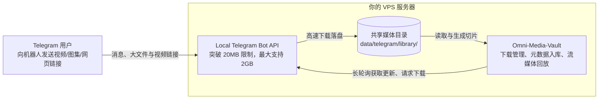

# Telegram 与 Local Bot API 高速接入指南

本文档说明如何接入 Telegram 机器人，并部署本地 `telegram-bot-api` 容器以支持最高 **2GB** 大文件高速转存。

---

## 1. 架构流向



> [!NOTE]
> Telegram 官方公网 Bot API 限制单文件下载最大仅 **20 MB**。若要转存高清长视频或大文件，必须部署本地 `telegram-bot-api` 服务（支持高达 **2GB** 文件下载）。

---

## 2. 准备 Telegram 凭证信息

1. **Bot Token**：在 Telegram 中搜索并私聊官方机器人 `@BotFather`，发送 `/newbot` 创建新机器人并获取 API Token。
2. **API ID & API Hash**：登录 [my.telegram.org](https://my.telegram.org)，进入 **API development tools** 创建应用即可获取专属的 `api_id` 与 `api_hash`（用于本地 Bot API 登录 Telegram 核心网络）。

---

## 3. 部署 Local Bot API 服务

<details open>
<summary><b>方式一：一键脚本部署</b></summary>

**1. 编辑安装目录中的 `telegram.yml`**
```bash
cd /opt/video-site-91
sudo nano telegram.yml
```

**2. 在 `telegram.yml` 中填入你的应用凭证**
```yaml
TELEGRAM_API_ID: "你的应用ID"
TELEGRAM_API_HASH: "你的应用Hash"
```

**3. 启动 Local Bot API 容器**
```bash
sudo docker compose -f telegram.yml up -d --pull always
```

**4. 重启 Omni-Media-Vault 服务**
```bash
sudo 91 restart
```

</details>

<details>
<summary><b>方式二：Docker Compose 部署</b></summary>

**1. 在存放 `docker-compose.yml` 的目录下，下载支持 Telegram Bot API 的编排配置**
```bash
curl -fsSL https://raw.githubusercontent.com/z08w12/omni-media-vault/main/tg-docker-compose.yml -o tg-docker-compose.yml
```

**2. 替换为新编排配置（注意备份你原有的自定义修改）**
```bash
mv docker-compose.yml docker-compose.yml.bak
mv tg-docker-compose.yml docker-compose.yml
```

**3. 编辑 `docker-compose.yml` 补充凭据**
```yaml
TELEGRAM_API_ID: "你的应用ID"
TELEGRAM_API_HASH: "你的应用Hash"
```

**4. 启动容器**
```bash
docker compose pull && docker compose up -d
```

</details>

---

## 4. Web 管理后台配置

1. 打开浏览器登录 Web 管理后台，进入 **配置面板 → Telegram**：
   - 填入 `@BotFather` 提供的 **Bot Token**；
   - 开启 Telegram 支持并保存；
   - 点击保存后，进入后台 **Telegram 监控页面** 查看连接状态与心跳。
2. 私聊你的机器人发送 `/id`，机器人会回复你的 Telegram 纯数字 ID；
3. 将该数字 ID 填入后台 **配置面板 → Telegram** 的「允许的用户 ID」白名单列表中保存。

现在，你可以直接向机器人发送视频、照片、多图图集（Media Group），或直接发送外部视频链接（X/Twitter、YouTube、TikTok、抖音、B站等），系统将自动进行解析、转存与归档！
